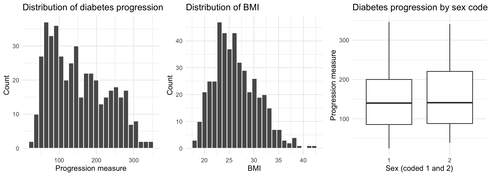
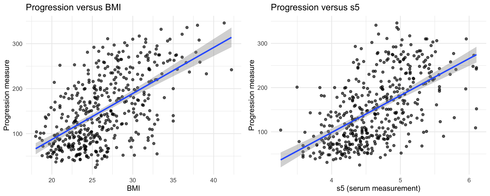

```{r setup, include=FALSE}
knitr::opts_chunk$set(echo = FALSE, message = FALSE, warning = FALSE,
                      fig.align = "center")
library(dplyr)
library(broom)

d <- read.table("../data/diabetes.tab.txt", header = TRUE, sep = "\t")
names(d) <- tolower(names(d))
d <- d %>% rename(progression = y)
d$sex <- factor(d$sex)

f <- function(x, k = 0) formatC(x, format = "f", digits = k)

mA <- lm(progression ~ bmi + s5, data = d)
mB <- lm(progression ~ bmi + bp + s5, data = d)
cB <- tidy(mB, conf.int = TRUE) %>% filter(term != "(Intercept)")
q  <- quantile(d$progression, c(0.25, 0.75))
qb <- quantile(d$bmi, c(0.25, 0.75))
```

## The question and the data

**Which patient characteristics go with faster diabetes progression, and what can we safely conclude?**

- `r nrow(d)` patients, each measured once at the start
- 10 baseline measures: age, sex, body mass index (BMI), blood pressure and six blood serum measurements
- Outcome: a progression score one year later (higher means more progression)
- No missing values and no duplicate records

\vspace{0.6em}
\small
Data: NCSU copy of the diabetes dataset.

## What the data look like

```{r fig-dist, out.width="88%"}

```

- Progression varies a lot: the middle half of patients score between `r f(q[1])` and `r f(q[2])` (full range `r f(min(d$progression))` to `r f(max(d$progression))`)
- Most patients have a BMI between `r f(qb[1])` and `r f(qb[2])`; the two sex codes look similar

## Which measures go with higher progression?

```{r fig-scatter, out.width="88%"}

```

- Higher BMI and higher s5 (one of the serum measurements) go with higher progression
- Blood pressure also goes with higher progression, but less strongly

## What the combined picture shows

Comparing patients who are otherwise similar on the other measures, **on average**:

- Each extra **BMI** point goes with about **`r f(cB$estimate[cB$term == "bmi"], 1)`** more progression points
- Each extra unit of **s5** goes with about **`r f(cB$estimate[cB$term == "s5"])`** more points (s5 only ranges from `r f(min(d$s5), 1)` to `r f(max(d$s5), 1)`)
- Each extra unit of **blood pressure** goes with about **`r f(cB$estimate[cB$term == "bp"], 1)`** more points, a smaller difference
- Together, these measures account for less than half of the differences between patients (about `r f(100 * summary(mA)$r.squared)`% to `r f(100 * summary(mB)$r.squared)`%)

## How much can we trust it?

**Fairly solid:**

- The same pattern appears in both versions of the analysis
- The size of the BMI difference is estimated fairly precisely: between about `r f(cB$conf.low[cB$term == "bmi"])` and `r f(cB$conf.high[cB$term == "bmi"])` points per BMI point

**Important cautions:**

- Individual patients vary a lot: a typical miss is about `r f(summary(mB)$sigma)` points on a scale from `r f(min(d$progression))` to `r f(max(d$progression))`
- The fit is weaker for patients with the lowest predicted progression
- The same patients were used to build and check the analysis, with no outside test

## What we can and cannot conclude

\begin{columns}[T]
\begin{column}{0.48\textwidth}
\textbf{We can say}

\begin{itemize}
\item Higher BMI and higher s5 go with higher progression, then blood pressure
\item These differences are clear in this group of patients
\end{itemize}
\end{column}
\begin{column}{0.48\textwidth}
\textbf{We should not say}

\begin{itemize}
\item That lowering BMI or s5 would slow progression
\item That we can predict progression for an individual patient
\item That the results apply to other groups of patients
\end{itemize}
\end{column}
\end{columns}

\vspace{0.8em}
These are observational data: other factors we could not see (diet, treatment, how long someone has had diabetes) may explain part of what we found. **We make no causal claims.**

## Questions and discussion

\centering
\vspace{1.5em}
\Huge Thank you
