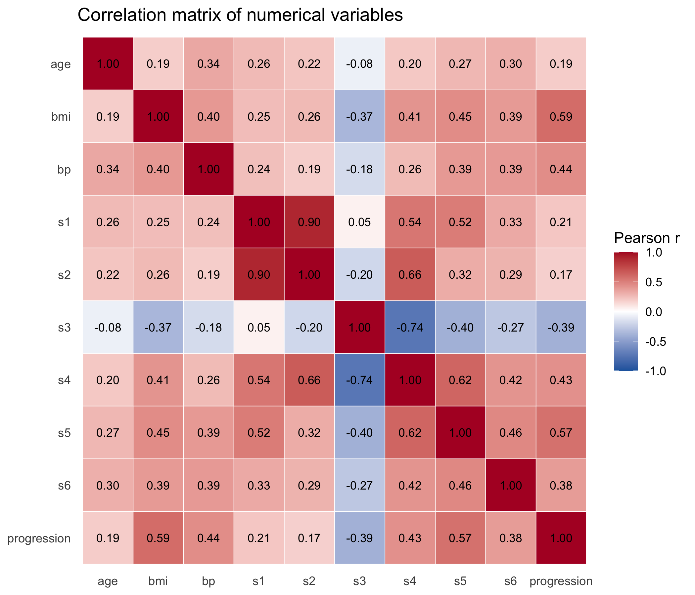
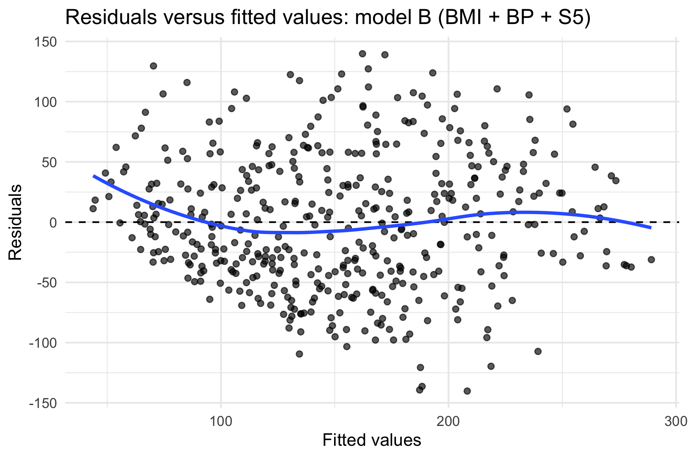

```{r setup, include=FALSE}
knitr::opts_chunk$set(echo = FALSE, message = FALSE, warning = FALSE,
                      fig.align = "center", out.width = "100%")
library(ggplot2)
library(dplyr)
library(broom)

# Data: same preparation as analysis/diabetes_analysis.R
d <- read.table("../data/diabetes.tab.txt", header = TRUE, sep = "\t")
names(d) <- tolower(names(d))
d <- d %>% rename(progression = y)
d$sex <- factor(d$sex)

f  <- function(x, k = 1) formatC(x, format = "f", digits = k)
fp <- function(p) ifelse(p < 0.001, "p < 0.001", paste0("p = ", formatC(p, format = "f", digits = 3)))
skew <- function(x) mean((x - mean(x))^3) / sd(x)^3
fences_above <- function(x) sum(x > quantile(x, 0.75) + 1.5 * IQR(x))

# Models
m_bmi <- lm(progression ~ bmi, data = d)
m_s5  <- lm(progression ~ s5, data = d)
mA    <- lm(progression ~ bmi + s5, data = d)
mB    <- lm(progression ~ bmi + bp + s5, data = d)
mC    <- lm(progression ~ bmi + bp + s5 + sex, data = d)

tb  <- tidy(mB, conf.int = TRUE)  %>% filter(term != "(Intercept)")
ta  <- tidy(mA, conf.int = TRUE)  %>% filter(term != "(Intercept)")
tc  <- tidy(mC, conf.int = TRUE)  %>% filter(term == "sex2")
ts  <- tidy(m_bmi, conf.int = TRUE)
gl  <- function(m) glance(m)

cm <- cor(d %>% select(where(is.numeric)))
cp <- cm[, "progression"]

vif_of <- function(model) {
  X <- model.matrix(model)[, -1, drop = FALSE]
  sapply(seq_len(ncol(X)), function(i) 1 / (1 - summary(lm(X[, i] ~ X[, -i, drop = FALSE]))$r.squared)) |>
    setNames(colnames(X))
}
vB <- vif_of(mB)
vA <- vif_of(mA)

anova_abc <- anova(mA, mB, mC)
cooks_B <- cooks.distance(mB)
fit_B <- fitted(mB); res_B <- resid(mB)
thirds <- cut(fit_B, quantile(fit_B, 0:3 / 3), include.lowest = TRUE)
sd_thirds <- tapply(res_B, thirds, sd)
sd_prog <- sd(d$progression)
```

# 1. Introduction and data

This report presents my analysis of the diabetes progression dataset for the final project of the Erasmus+ LEAP course *Data Analytics and Statistics with Applications*, delivered through AUTH eLearning. The question I address is: *which patient characteristics are associated with diabetes progression, what do regression models tell us, and what conclusions can reasonably be drawn from the data?* All numbers in this report were calculated from the supplied data in R; the code is in `analysis/diabetes_analysis.R`.

**Data.** The data file is a copy of the diabetes dataset hosted by NCSU (https://www4.stat.ncsu.edu/~boos/var.select/diabetes.tab.txt). Each row is one patient, and there are `r nrow(d)` patients. The outcome, `progression`, is a continuous measure of disease progression one year after baseline. The ten baseline predictors are age, sex, BMI (`bmi`), blood pressure (`bp`) and six serum measurements (`s1` to `s6`). The supplied files do not define the units of progression or the serum variables, and they do not say which sex code is female or male, so I report sex as "sex coded 1" (n = `r sum(d$sex == "1")`) and "sex coded 2" (n = `r sum(d$sex == "2")`). Sex is numerically coded in the file but represents categories, so I converted it to a factor and excluded it from the Pearson correlation matrix.

**Data quality.** There are `r sum(is.na(d))` missing values and `r sum(duplicated(d))` duplicated rows. I found no impossible values: age ranges from `r min(d$age)` to `r max(d$age)`, BMI from `r f(min(d$bmi))` to `r f(max(d$bmi))`, and blood pressure from `r min(d$bp)` to `r max(d$bp)`. The predictors are on their original measurement scales, not standardised.

**Responsible use.** These are health data, so interpretation needs care. The file contains no direct identifiers such as names, but small samples of health data can still be sensitive and should be handled and shared responsibly. The results describe associations between patient groups in one sample, and they should not be treated as predictions or judgements about any individual patient.

# 2. Exploratory analysis

```{r table1}
vars <- c("progression", "age", "bmi", "bp", "s1", "s2", "s3", "s4", "s5", "s6")
t1 <- do.call(rbind, lapply(vars, function(v) {
  x <- d[[v]]
  data.frame(Variable = v, Mean = f(mean(x), 2), Median = f(median(x), 2),
             SD = f(sd(x), 2), IQR = f(IQR(x), 2),
             Min = f(min(x), 1), Max = f(max(x), 1))
}))
knitr::kable(t1, booktabs = TRUE, align = "lrrrrrr",
             caption = "Descriptive statistics for the outcome and the numerical predictors (n = 442).")
```

Table 1 summarises the main variables. Diabetes progression has a mean of `r f(mean(d$progression))` and a median of `r f(median(d$progression))`, with a standard deviation of `r f(sd_prog)` and an interquartile range of `r f(IQR(d$progression))`. It is moderately right-skewed (skewness `r f(skew(d$progression), 2)`), with a peak at lower values and a long tail towards the maximum of `r max(d$progression)`. BMI is centred around a median of `r f(median(d$bmi))` with a mild right tail (skewness `r f(skew(d$bmi), 2)`); `r fences_above(d$bmi)` values lie above the upper boxplot fence.

```{r fig1, fig.cap="Distributions of diabetes progression and BMI (histograms), and diabetes progression by sex code (boxplots)."}
knitr::include_graphics("../figures/panel_distributions.png")
```

Progression is similar for the two sex codes: the median is `r f(median(d$progression[d$sex == "1"]))` for sex coded 1 and `r f(median(d$progression[d$sex == "2"]))` for sex coded 2, with a similar spread (Figure 1, right).

Several serum variables also have a few high values beyond the boxplot fences (s1: `r fences_above(d$s1)`, s2: `r fences_above(d$s2)`, s3: `r fences_above(d$s3)`, s5: `r fences_above(d$s5)`, s6: `r fences_above(d$s6)`). They look like the upper tails of mildly right-skewed variables, not obvious recording errors. I kept every row in the analysis, so these values should be read as a caution: they could have more influence on the estimates than other observations. Later checks showed that no single observation was highly influential. Because the outcome is only moderately skewed and I wanted coefficients that are easy to interpret, I left progression untransformed.

# 3. Relationships between variables

```{r fig2, fig.cap="Pearson correlation matrix of the numerical variables (sex is excluded because it is categorical).", out.width="78%"}

```

Figure 2 shows the correlation matrix. The variables most strongly associated with progression are BMI (r = `r f(cp["bmi"], 2)`) and s5 (r = `r f(cp["s5"], 2)`), followed by blood pressure (r = `r f(cp["bp"], 2)`), s4 (r = `r f(cp["s4"], 2)`) and s6 (r = `r f(cp["s6"], 2)`). s3 is the only meaningful negative association (r = `r f(cp["s3"], 2)`). Age, s1 and s2 are only weakly related to progression (r between `r f(cp["s2"], 2)` and `r f(cp["s1"], 2)`).

Some predictors are strongly related to each other. s1 and s2 are almost the same information (r = `r f(cm["s1", "s2"], 2)`), and s3 and s4 are also closely related (r = `r f(cm["s3", "s4"], 2)`), with s4 related to s2 and s5 as well (r = `r f(cm["s2", "s4"], 2)` and `r f(cm["s4", "s5"], 2)`). Using both s1 and s2 in one model would risk multicollinearity. BMI and s5 are moderately correlated with each other (r = `r f(cm["bmi", "s5"], 2)`). For further analysis, BMI and s5 look most promising because they have the strongest association with progression and are not too strongly related to each other; blood pressure was added as a third candidate.

```{r fig3, fig.cap="Diabetes progression versus BMI (left) and versus s5 (right), with fitted straight lines and 95% confidence bands."}
knitr::include_graphics("../figures/panel_scatterplots.png")
```

Both scatterplots (Figure 3) show an upward trend with wide scatter around the line. I chose s5 as the second scatterplot because, after BMI, it has the strongest correlation with progression.

# 4. Regression modelling

**Simple regression.** I used BMI as the predictor because it is meaningful and has the highest correlation with progression. The fitted equation is

progression = `r f(coef(m_bmi)[1], 2)` + `r f(coef(m_bmi)[2], 2)` × BMI.

The slope means that patients with a BMI one unit higher have, on average, progression `r f(coef(m_bmi)[2])` points higher (95% CI `r f(ts$conf.low[2])` to `r f(ts$conf.high[2])`). The intercept has no useful real-world meaning because a BMI of 0 is impossible. R² is `r f(gl(m_bmi)$r.squared, 3)`, so a straight line in BMI accounts for about `r f(100 * gl(m_bmi)$r.squared, 0)`% of the variation in progression, and about two thirds remains unexplained. A simple model using s5 gave a similar fit (R² = `r f(gl(m_s5)$r.squared, 3)`).

**Multiple regression.** I fitted three candidate models: A (BMI + s5), B (BMI + BP + s5), and C (B plus sex as a categorical variable). I keep A as the parsimonious model and B as the fuller model. Table 2 compares them using R², adjusted R², residual standard error, AIC and BIC, together with the BMI-only model.

```{r table2}
cmp <- bind_rows(
  gl(m_bmi) %>% mutate(Model = "Simple: BMI"),
  gl(mA)    %>% mutate(Model = "A: BMI + s5"),
  gl(mB)    %>% mutate(Model = "B: BMI + BP + s5"),
  gl(mC)    %>% mutate(Model = "C: BMI + BP + s5 + sex")
) %>%
  transmute(Model, `R²` = f(r.squared, 3), `Adj. R²` = f(adj.r.squared, 3),
            `Residual SE` = f(sigma, 1), AIC = f(AIC, 0), BIC = f(BIC, 0))
knitr::kable(cmp, booktabs = TRUE, align = "lrrrrr",
             caption = "Comparison of the simple and multiple regression models.")
```

```{r table3}
co <- bind_rows(
  ta %>% mutate(Model = "A"), tb %>% mutate(Model = "B")
) %>%
  transmute(Model, Term = term, Estimate = f(estimate, 2), SE = f(std.error, 2),
            `95% CI` = paste0(f(conf.low, 2), " to ", f(conf.high, 2)),
            t = f(statistic, 2), p = ifelse(p.value < 0.001, "<0.001", f(p.value, 3)))
knitr::kable(co, booktabs = TRUE, align = "llrrrrr",
             caption = "Coefficients for models A and B (progression per one unit of each predictor).")
```

Adding s5 to BMI improves the fit most (R² from `r f(gl(m_bmi)$r.squared, 3)` to `r f(gl(mA)$r.squared, 3)`). Adding blood pressure improves it further (`r f(gl(mB)$r.squared, 3)`), and the improvement is supported by the F-test (`r fp(anova_abc$"Pr(>F)"[2])`) and by a lower AIC and BIC. Model C changes the fit only slightly. I therefore did not judge the models from R² alone: model B has a clear but modest advantage over A, whereas the extra gain from C is small.

In model B, holding the other predictors constant, a one-unit higher BMI is associated with `r f(tb$estimate[tb$term == "bmi"])` points higher progression, and a one-unit higher s5 with `r f(tb$estimate[tb$term == "s5"])` points higher progression. Holding BMI and s5 constant, one more unit of blood pressure is associated with `r f(tb$estimate[tb$term == "bp"], 2)` points higher progression. The BMI coefficient is smaller once other predictors are included (`r f(coef(m_bmi)[2])` alone, `r f(ta$estimate[ta$term == "bmi"])` with s5, `r f(tb$estimate[tb$term == "bmi"])` with s5 and BP), which indicates that BMI shares some of its association with s5 and BP.

# 5. Model evaluation and uncertainty

```{r fig4, fig.cap="Residuals versus fitted values for model B (BMI + BP + S5). The blue line is a smoothed trend.", out.width="62%"}

```

**Residuals.** Figure 4 shows residuals against fitted values for model B; model A gives a similar picture (`figures/residuals_vs_fitted_model_a.png`). The smoothed line stays close to zero over most of the range, but it rises above zero at the lowest fitted values, so the model tends to under-predict for patients with the lowest predicted progression. The spread is also smaller there: the residual standard deviation is `r f(sd_thirds[1])` in the lowest third of fitted values compared with `r f(sd_thirds[2])` and `r f(sd_thirds[3])` in the other two. I regard this as a mild warning sign, not a serious violation. The outcome cannot fall below its observed minimum of `r min(d$progression)`, which may contribute, but I cannot confirm this from the data. The largest Cook's distance was `r f(max(cooks_B), 3)`, so no single observation dominated the fit.

**Multicollinearity.** The variance inflation factors are at most `r f(max(vB), 2)` in model B (BMI `r f(vB["bmi"], 2)`, BP `r f(vB["bp"], 2)`, s5 `r f(vB["s5"], 2)`) and `r f(max(vA), 2)` in model A, consistent with the moderate correlations seen earlier. By avoiding s1 and s2 together I avoided the main multicollinearity problem in this dataset.

**Uncertainty.** In model B the BMI coefficient is `r f(tb$estimate[tb$term == "bmi"], 2)` (95% CI `r f(tb$conf.low[tb$term == "bmi"], 2)` to `r f(tb$conf.high[tb$term == "bmi"], 2)`; t = `r f(tb$statistic[tb$term == "bmi"], 2)`), and the s5 coefficient is `r f(tb$estimate[tb$term == "s5"], 1)` (95% CI `r f(tb$conf.low[tb$term == "s5"], 1)` to `r f(tb$conf.high[tb$term == "s5"], 1)`; t = `r f(tb$statistic[tb$term == "s5"], 2)`). Both are estimated reasonably precisely and neither interval is close to zero. The interval for s5 is wide in absolute terms, but one unit of s5 is a large step: s5 only ranges from `r f(min(d$s5), 1)` to `r f(max(d$s5), 1)`.

**Statistical versus practical importance.** The p-values are very small, but this partly reflects the sample size of `r nrow(d)` and does not by itself mean the effects are large. The residual standard error of model B is `r f(gl(mB)$sigma, 1)`, compared with a standard deviation of progression of `r f(sd_prog, 1)`: even with BMI, BP and s5, individual patients vary a lot around the fitted values. The blood pressure coefficient is statistically clear (`r fp(tb$p.value[tb$term == "bp"])`) but small in practical terms, at about `r f(tb$estimate[tb$term == "bp"], 1)` points per unit. Because the meaning and units of progression are not defined in the supplied files, I cannot say what size of difference would be clinically important; I only compare coefficients with the spread of the outcome.

# 6. Causality, limitations and conclusions

**Observational data and causation.** The data appear to be observational: patient characteristics were measured and not assigned. For that reason the regression coefficients describe how patients with different characteristics differ on average; they are not estimates of what would happen if a characteristic were changed. The predictors were measured at baseline and the outcome one year later, which gives a time ordering but does not remove confounding. I make no causal claims in this report.

**Confounding and measurement.** Several factors that are not in the dataset could plausibly be related to both the predictors and progression: diet and physical activity; medication and treatment received; duration of diabetes and baseline disease severity; and family history, smoking and socioeconomic factors. Progression is a single summary measure with an unknown definition and unknown units, the serum variables are unlabelled in the supplied files, and every variable is a single baseline measurement that will contain some measurement error.

**Generalisability.** The source population, setting and time period of the sample are not described. Patients are aged `r min(d$age)` to `r max(d$age)`, and the results may not hold for other age groups or populations. The models were fitted and evaluated on the same patients without external validation, so their accuracy on new patients would probably be lower.

**Further limitations.** In addition to the points above: the residual plot shows a mild warning sign at low fitted values; explanatory power is modest (R² of `r f(gl(mA)$r.squared, 2)` to `r f(gl(mB)$r.squared, 2)`), with large individual-level error; the estimates depend on which predictors are included; and extreme serum values were kept in the data. In model C, sex coded 2 versus sex coded 1 had a coefficient of `r f(tc$estimate, 1)` (95% CI `r f(tc$conf.low, 1)` to `r f(tc$conf.high, 1)`; `r fp(tc$p.value)`). This is a borderline result with an undocumented coding, so I do not emphasise it.

**What the analysis supports.** Patients with higher BMI and higher s5 tend to have higher progression one year later, and blood pressure is also positively associated, with a smaller association. BMI and s5 are the most strongly associated variables, followed by blood pressure. These associations appear in both models A and B, are estimated with reasonable precision, and the models explain roughly `r f(100 * gl(mA)$r.squared, 0)`% to `r f(100 * gl(mB)$r.squared, 0)`% of the variation in progression.

**What goes beyond the evidence.** The data do not show that lowering BMI or s5 would slow progression, that the model can predict progression accurately for an individual patient, that the findings apply to other populations or settings, that there are sex differences in progression, or that any clinical threshold or treatment recommendation follows.

**Note on the outcome scale.** I kept progression untransformed because its skew is moderate and I wanted the regression coefficients to remain easy to interpret.

*Data source:* NCSU copy of the diabetes dataset, https://www4.stat.ncsu.edu/~boos/var.select/diabetes.tab.txt

# Appendix: Reflection

I found the course detailed but easy to follow. It was well structured, and the knowledge was introduced step by step in a logical order, so each topic built naturally on the previous one. The foundation paths were especially interesting, and the interactive plots were very helpful for understanding how regression works.

The main difficulty was timing. Most of the material was released close to the deadline, which left little time for detailed study and for working through the topics in depth.

Working on this project taught me how much care is needed to interpret regression results. A statistically significant coefficient is not necessarily large in practical terms, the coefficient for BMI changed depending on which other predictors were in the model, and an association in observational data is not evidence of causation. With more time, I would like to check the models on separate data and examine the weaker fit at low predicted progression more closely.
